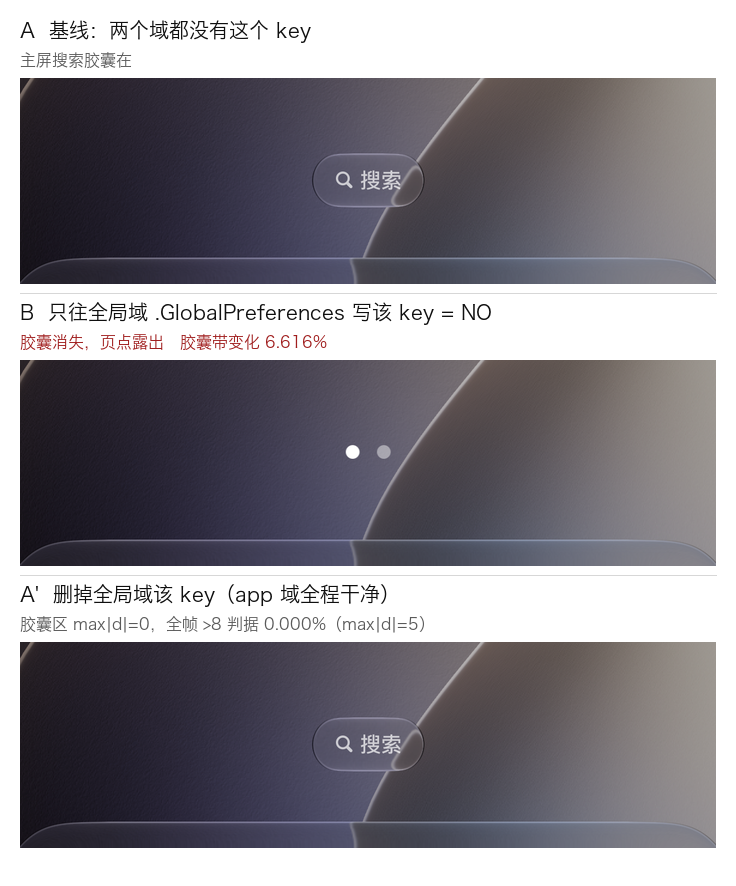

# SpringBoard Tweak 候选报告

> 生成时间：2026-09-13
> 证据基线：iOS 27.0 simruntime（24A5380i）+ 真机备份 00008130-001431082E40001C（iPad16,2 / iOS 27.0 / 24A5424a）
> 目标产物：可直接进 `src/tweaks/registry.py` 的候选 key 清单

---

## 1. 结论摘要

| 指标 | 数值 |
|---|---|
| SpringBoardFoundation 键表内 `SB*` key 总数 | **392** |
| 其中 accessor/key **严格相邻**配对 | **287** |
| 非严格配对（loose） | 105 |
| registry 已使用的 `SB*`/`SBF*`/`UISolarium*` key | 30 |
| **严格配对差集（新增候选）** | **264** |
| loose 差集 | 105 |
| 新增候选中**真机备份已落盘** | 22 |
| 本次**活体 A/B/A 实测**不同 key 数 | **32**（轮次 1–7 见 §3.2e；轮次 8/9 见 §3.2f） |
| 其中**证实有可见效果** | **1**（`SBHomeScreenShowsSearchAffordance`，命中率 **3.1%**） |
| registry 走 Managed Preferences 的条目 | 131 / 133 |
| 全局域（`.GlobalPreferences`）通道**已证实能穿透到 SpringBoard** | ✅ 见 §12 |

> **口径**：本报告只统计 **`SB*` 族**的 key，所以"实测 32 / 有效 1"是 SB 族内的数字。
> 全项目（含 UIKit / GP 域）实测有效的键值对共 **2 个** —— 另一个是
> `com.apple.UIKit/UIViewGlassTintAmount`，汇总见 `docs/data/effective_key_value_pairs.md`。

**最重要的一条结论：accessor 存在 ≠ 改了有效。**
九轮模拟器受控实验共测 **32** 个「键表严格配对 + 值确实落盘」的 key，只有 **1** 个产生可见效果（且该 key 经正向/反向双向复现，对照差分完全对称）。因此本报告把 264 个候选**全部**标为"待活体验证"，只把经 A/B/A 证实的 1 个列为可用。

轮次 8/9 的价值不在新增命中（**0 项**），而在**推翻了三条会批量伪造结论的判据** ——
详见 §3.2f 与 `docs/data/springboard_round8_9_log.md`。

---

## 2. 方法论与证据分级

### 2.1 证据来源

| 来源 | 内容 | 强度 |
|---|---|---|
| iOS 27 simruntime 共享缓存 | `dyld_sim_shared_cache_arm64` 中 SpringBoardFoundation.framework 的 accessor/key 字符串池 | 强（真实二进制） |
| 真机 MobileSync 备份 | `HomeDomain` / `ManagedPreferencesDomain` 的 `com.apple.springboard.plist`（未加密，可直读） | 强（SpringBoard 自己写入） |
| 模拟器活体 A/B/A | 写 key → 重启 SpringBoard → 截屏差分 → 反向写回 → 再差分 | 最强（可见效果为唯一判据） |

### 2.2 配对判据

在 `__cstring` 池中，`SB<Key>` 与其 camelCase accessor（如 `SBShowBatteryPercentage` ↔ `showBatteryPercentage`）**在内存中严格相邻**（前串的 NUL 结束位置正好等于后串起点）时记为 `STRICT`。这是 Swift/ObjC `@objc` 常量 + `defaults` accessor 在同一 translation unit 中的典型落盘形态。

### 2.3 分级定义

| 级别 | 定义 | 可用性 |
|---|---|---|
| **Tier A 已证实** | A/B/A 实验产生可复现的可见变化，且反向恢复后画面与基线 **0.000%** 一致 | 可直接上线 |
| **Tier B 实物支持** | 真机备份中该 key 已被 SpringBoard 自身写入 | 键有效，效果待验证 |
| **Tier C 高置信推断** | 键表严格配对 + NUL 相邻，但无真机落盘、无活体证据 | 待验证 |
| **Tier D 弱证据** | 仅 loose 配对（无相邻 accessor） | 需逐个验证，含已知反例 |
| **排除** | 危险 key / 明确非 pref（通知名、内部常量） | 不用 |

---

## 3. 关键实验：为什么必须做活体验证

### 3.1 实验设计（A/B/A）

```
写 key → defaults 读回确认 → kickstart SpringBoard
→ 等 70s，截屏；若 <1MB 判定未渲染，等 30s 重采（最多 4 次）
→ 反向写回 → 重启 → 再截屏 → 像素级差分
```

**阳性对照**：`simctl ui <udid> appearance dark` ↔ `light`，差分 **99.07%** —— 证明差分管线能可靠检出变化。

### 3.2 实验结果（第一轮 · 手工 A/B/A）

| Key | 写入值 | 读回 | 可见变化 | 判定 |
|---|---|---|---|---|
| `SBHomeScreenShowsSearchAffordance` | NO | 0 → 1（反向） | **搜索胶囊消失；恢复后 0.000% 一致** | ✅ **Tier A** |
| `SBShowBatteryPercentage` | YES | 1 | 0.000% | ❌ 无效 |
| `SBMaxIconListCount` | 5 | 5 | 0.000% | ❌ 无效 |
| `SBHomeHideLabels` | YES | 1 | 0.000% | ❌ 无效 |
| `SBRecentsEnabled` | YES | 1 | Dock 0.000% | ❌ 无效 |
| `SBAppLibraryInDockEnabled` | YES | 1 | Dock 0.000% | ❌ 无效 |

### 3.2b 实验结果（第二轮 · 增量式批量扫描，含内建阳性对照）

设计：每个 key 单独 respring，与**上一帧**差分 → 单键归因（避免多键同写导致无法归因）；末尾写一个已知有效的 key 做内建阳性对照。

| Key | 写入值 | 增量变化 | 判定 |
|---|---|---|---|
| `SBShowRingerState` | YES | 全屏 0.000% | ❌ 无效 |
| `SBShowBatteryLevel` | NO | 全屏 0.000% | ❌ 无效 |
| `SBDisableLiveIcons` | YES | 全屏 0.000% | ❌ 无效 |
| `SBShouldInsertDownloadFileStackIconToFloatingDock` | YES | 全屏 0.000% | ❌ 无效 |
| `SBShowRSSI` | YES | 0.000%（见下方推断） | ❌ 无效 |
| **`SBHomeScreenShowsSearchAffordance`（对照）** | NO | **全屏 0.158% / 主屏中 0.264%** | ✅ **复现有效** |
| 清理后回落（对照反向） | — | **全屏 0.158%（完全对称）** | ✅ 可逆 |

**`SBShowRSSI` 的归因**：该轮基线帧采集失败（空屏），无法做直接 A/B。但 t5 帧同时含上述 5 个 key，而 `final`（清理后、已渲染）与 `t5` 差分 **0.000%**，与 `t1` 差分同样 **0.000%**；其中 4 个键已单独测出 0.000% ⇒ 由差分传递性推得 `SBShowRSSI` 亦为 0.000%。

### 3.2c 第三轮 · 排除「状态栏 override 旁路」这一解释

第二轮里状态栏类 key 全为 0.000%，有一个自然的怀疑：**模拟器状态栏被 `simctl status_bar` override 整体替换，SpringBoard 的渲染被旁路**。

**第一步：证实 override 确实替换了状态栏**

```
override 生效  vs  清除 override
  状态栏整条        4.031%
    左(时钟/运营商)  4.105%
    右(信号·WiFi·电池) 5.309%
  状态栏以外        0.000%     ← 证明变化只发生在状态栏
```

**第二步：在 override 已清除的状态下复测**

| Key | 栏左(时钟·噪声源) | **栏右(信号/WiFi/电池·测试区)** | 主屏中(对照检测区) | 判定 |
|---|---|---|---|---|
| `SBShowBatteryLevel` = NO | 2.849% | **0.000%** | 0.000% | ❌ 无效 |
| `+SBShowRingerState` = YES | 1.464% | **0.000%** | 0.000% | ❌ 无效 |
| `+对照(搜索胶囊)` | 0.534% | 0.000% | **0.264%** | ✅ 对照有效 |
| 清理后 | 0.453% | 0.000% | **0.264%** | 对照对称 |
| 清理校验 R0 vs R4 | 3.465% | 0.000% | 0.000% | ✅ 复原 |

**结论：override 不是它们失效的原因。** 清除 override 后这两个状态栏 key 在测试区依然 0.000%，而同一轮的阳性对照正常触发并对称复原。⇒ 这批状态栏 key 在模拟器里是**真惰性**（不渲染该通路 / 可能需要 AppleInternal 构建），与 override 无关。

**顺带量化了一个噪声源**：清除 override 后时钟开始走，状态栏左区噪声 **0.45%–3.47%**。所以测状态栏类 key 必须只比**右区**，左区只能当噪声。

**前三轮合计：11 个不同 key，仅 1 个有效。阳性对照在 3 轮中均触发且均可逆。**

### 3.2d 第四轮 · 通道探针 + 新增元素型候选（详见 §12）

| 项目 | 结果 |
|---|---|
| 全局域通道探针（已知有效 key 写进 `.GlobalPreferences`） | ✅ **生效**，撤销后与基线 0.000% |
| `SBWidgetSnapshotDebugLabels` / `SBShouldShowWidgetIntroductionPage` / `SBHomeShouldShowLibraryEducationView` | ❌ 三者均 0.000% |

### 3.2e 实测 key 全清单（18 个 / 轮次 1–7）—— 供审计

| # | Key | 轮次 | 写入值 | 结果 |
|---|---|---|---|---|
| 1 | `SBHomeScreenShowsSearchAffordance` | 1/2/3/4 | NO | ✅ **有效**（双向复现，反向 0.000%） |
| 2 | `SBShowBatteryPercentage` | 1 | YES | ❌ 0.000% |
| 3 | `SBMaxIconListCount` | 1 | 5 | ❌ 0.000% |
| 4 | `SBHomeHideLabels` | 1 | YES | ❌ 0.000% |
| 5 | `SBRecentsEnabled` | 1 | YES | ❌ Dock 0.000% |
| 6 | `SBAppLibraryInDockEnabled` | 1 | YES | ❌ Dock 0.000% |
| 7 | `SBShowRingerState` | 1/3 | YES | ❌ 0.000% |
| 8 | `SBShowBatteryLevel` | 2/3 | NO | ❌ 0.000% |
| 9 | `SBDisableLiveIcons` | 2 | YES | ❌ 0.000% |
| 10 | `SBShouldInsertDownloadFileStackIconToFloatingDock` | 2 | YES | ❌ 0.000% |
| 11 | `SBShowRSSI` | 2 | YES | ❌ 0.000%（传递性推得） |
| 12 | `SBWidgetSnapshotDebugLabels` | 4 | YES | ❌ 0.000% |
| 13 | `SBShouldShowWidgetIntroductionPage` | 4 | YES | ❌ 0.000% |
| 14 | `SBHomeShouldShowLibraryEducationView` | 4 | YES | ❌ 0.000% |
| 15 | `SBHomeIconUserInterfaceStyle` | 5/6/7 | `accent`/`color`/`default`/`clear`… | ❌ 不可复现（见 §13） |
| 16 | `SBHomeIconUserInterfaceStyleVariation` | 6/7 | `dark`/`light` | ❌ 0.000% |
| 17 | `SBHomeIconUserInterfaceStyleSaturation` | 5/6 | `2.0` | ❌ 0.001% |
| 18 | `SBHomeIconUserInterfaceStyleLuminance` | 5/6 | `0.5` | ❌ 0.000% |

**18 测 1 中（5.6%）。** 阴性 17 个。

> 轮次 8/9 新增 14 个 key 的清单见 **§3.2f**；本表与 §3.2f 合起来是报告内所有 key 计数数字的唯一出处。

### 3.2f 第五 / 第六轮 · 轮次 8–9（14 个新 key）—— 命中 0，但推翻三条判据

完整记录见 **`docs/data/springboard_round8_9_log.md`**。摘要：

**轮次 8（12 个 key，单值法）**

| 结论 | 数 | key |
|---|---|---|
| 干净阴性（去状态栏 0.000–0.002%） | **7** | `SBRingerMuted`、`SBHomeLargeIcons`、`SBEnableHomeScreenWallpaperDimming`、`SBDisableParallaxOnPageControl`、`SBShowInternalWidgets`、`SBNeverRenderSystemApertureFillOnGPU`、`SBMainDisplayDarkeningPercentage` |
| **不可判** —— 元素不在采集通路 | 2 | `SBAlwaysRenderSystemApertureFillOnGPU`：**模拟器截图里没有动态岛**，整族不可判 |
| **不可判** —— 前置条件静态不可达 | 4 | `SBShowThermalWarning`（需发热）、`SBShowRegionOfInterest`（需交互）、`SBEnableSecureDrawViolationAlerts`（需违例）、`SBHomeScreenShowsBadgesInAppLibrary`（需 badge 数据） |

**轮次 9（换「同 key 双值互比」法，第 1–2 个 key 已完成）**

| key | A vs B | 去状态栏 | 判定 |
|---|---|---|---|
| `SBShowInternalApps` | true vs false | **0.000%** | 惰性 |
| `SBWallpaperZoomScaleHomeScreen` | 2.0 vs 0.5 | **0.002%** | 惰性 |

第 3–7 个 key + 阳性对照因**采集停顿中止**（未查明原因，见日志 §8.4）。

**本轮真正产出：推翻三条会批量伪造结论的判据。**

| 原判据 | 被推翻成 | 证据 |
|---|---|---|
| 「冻结状态栏时间」就够 | **还要把状态栏带整条屏蔽**（`y<0.075·H`） | 固定 override 下同条件帧间差 **0.99–1.01%** ≈ 不同条件间的 **1.00%**；根因是状态栏整条会随机不渲染（近白像素 4564 → 0） |
| 「帧大小中位数 ±0.05%」当闸门 | **必须先分态**（双峰时全局中位数会落在空档，全帧误杀） | 有/无状态栏两组中位数相差 **0.079–0.108%**，16 帧全超 ±0.05% |
| 「写 `true` 测 key 是否惰性」 | **写入值可能就等于默认值 ⇒ 伪造完美阴性** | 12 个 key 里 1 个写入值极可能≈默认；另有 4 个前置不可达 |

并**更正两处此前记录**：`accent` 假阳性（1.242%）与 0.239% 的那个"非零"是**两个不同伪影**
（过渡帧 / 状态栏消失），不是同一个"瞬态渲染态"。

### 3.3 Tier A 详细数据

```
基线      vs 移除搜索胶囊    全屏 0.158%   搜索区 0.428%   状态栏 0.000%
基线      vs 恢复搜索胶囊    全屏 0.000%   搜索区 0.000%   状态栏 0.000%
移除      vs 恢复            全屏 0.158%   搜索区 0.428%
```

"基线 vs 恢复" 全屏 **0.000%** 是决定性证据：改动完全可逆、确定性生效。

> **踩坑记录（两轮都踩到，务必按此实现）**：首轮 `tools/sim_tweak_verify.py` 报"全屏变化 0.000%"，一度以为键无效。实际是 respring 后 SpringBoard 未稳定，工具在**空屏**状态下采集。
> - respring 后 25s：状态栏尚未恢复（截屏 77KB vs 正常 4.5MB）
> - **等 70s 仍偶发空屏** —— 第二轮扫描的基线帧就是这样废掉的
>
> 所以不能用固定 sleep，必须用**帧有效性判据**并重采。
> ~~初版判据是 `截屏文件大小 ≥ 1MB`~~ —— **该判据已在轮次 5–7 被证明太松**：它放过了 4.319 MB 的
> 半渲染帧（占正常体积 95.4%），而那正是唯一一个假阳性（§13.2）。
> ~~「帧大小中位数 ±0.05%」~~ —— **该判据已又在轮次 8 被证明不能单用**：帧大小常呈**双峰**
> （有无状态栏两档，实测相差 0.079–0.108%），全局中位数会落在两峰之间的空档，**导致全帧误杀**。
>
> **现行判据（三条分级，`tools/sim_ab_analyze.py` 已实现）**：
>
> | 闸门 | 判据 | 处置 |
> |---|---|---|
> | 息屏 | 帧 < 50% 最大帧 或 全屏均值 < 10 | FATAL 重采（实测 77 KB 帧） |
> | 过渡帧 | 帧大小偏离**本组**中位数 > 1% | FATAL 重采 |
> | 状态栏伪影 | 状态栏像素数与基线不同 | BENIGN，**屏蔽 `y<0.075·H` 后继续用** |
>
> 外加「同一值独立复现 ≥2 次」。这一条不做，既会读出完美的 0.000% 假阴性，
> 也会读出 1.242% 的假阳性 —— 且假阳性**数量级可达 0.27%**（§3.2f）。

---

## 4. Tier A —— 已证实可用（已落地）

### `SBHomeScreenShowsSearchAffordance`

| 项 | 值 |
|---|---|
| 效果 | 设为 `NO` 移除主屏底部"搜索"胶囊 |
| 类型 | bool |
| accessor | `showsHomeScreenSearchAffordance` |
| 目标位置 | `FileLocation.springboard`（`/var/Managed Preferences/mobile/com.apple.springboard.plist`） |
| **TweakID** | **`TweakID.HideHomeSearchPill`** |
| **Section** | **`Section.SPRINGBOARD`** |
| 生效默认值 | 开启 → 写入 `False`（隐藏胶囊） |
| min_version | `26.0` |
| 风险 | 低（纯 UI，可逆） |

**✅ 已实现并验证。** 落地位置：

- `src/tweaks/tweak_names.py` — 枚举新增 `HideHomeSearchPill = auto()`
- `src/tweaks/registry.py` — SpringBoard 段末尾新增一条 `_t(...)`

```python
_t(TweakID.HideHomeSearchPill, Section.SPRINGBOARD, "Hide Home Screen Search Pill",
   FileLocation.springboard, "SBHomeScreenShowsSearchAffordance", value=False,
   min_version="26.0",
   description=QT_TRANSLATE_NOOP("Nugget", "Removes the Search capsule above the Dock on the Home Screen. Enabled when the switch is ON. Verified on iOS 27: toggling it off restores the pill exactly.")),
```

**验证结果**（本机无 PySide6，注入最小 stub 后走真实构造路径）：

| 检查项 | 结果 |
|---|---|
| `py_compile` 两文件 | ✅ |
| 枚举成员存在且无重名（140 个） | ✅ |
| registry 中恰好一条 spec，字段全部正确 | ✅ |
| 进入 `SPECS_BY_SECTION[SPRINGBOARD]`（17 条） | ✅ |
| 进入 `SPECS_BY_ID` | ✅ |
| 归属特性 `SECTION_FEATURES` → `"Springboard"` | ✅ |
| `FEATURE_TWEAKS["Springboard"]` 含 `HideHomeSearchPill` | ✅ 可被 HotLoad 规则按名屏蔽 |
| key 未被其它 tweak 占用 | ✅ |
| `BasicPlistTweak` 关闭时不写入 / 开启时写入 `False` | ✅ |
| 与同文件既有 key（`SBDisableParallax`）合并不覆盖 | ✅ |
| i18n：`src/tweaks/*.py` 已在 `i18n/scripts/update_base_translation.sh` 的 lupdate 清单内 | ✅ 新字符串会自动进入基翻译 |

> 无需手改 `i18n/*.ts`（那是独立仓库 `gNugget-i18n` 的产物，由 lupdate 脚本刷新）。

---

## 5. Tier B —— 真机备份已落盘（键有效，效果待验证）

以下 22 个 key 出现在真机 `com.apple.springboard.plist` 中，证明 SpringBoard 自身读写该 key。

| Key | 真机值 | 类型 | 说明 |
|---|---|---|---|
| `SBAppLibraryInDockEnabled` | `True` | bool | Dock 显示 App 资源库入口 ⚠️ 模拟器实测无可见效果 |
| `SBChamoisWindowingEnabled` | `False` | bool | iPad 新版窗口化多任务 |
| `SBMedusaMultitaskingEnabled` | `True` | bool | iPad 多任务总开关 |
| `SBCoverSheetGesturalDismissalCount` | `10` | number | 锁屏手势关闭计数（运行时状态，**勿写**） |
| `SBCoverSheetGrabberSuccessfulPullCount` | `2` | number | 同上（**勿写**） |
| `SBDisplayIDsWithBadgingEnabled` | `[...]` | array | 允许角标显示的 App 列表（**勿写**） |
| `SBFlexibleWindowingAutomaticStageCreationEnabledExternal` | `False` | bool | 外接屏自动建 Stage |
| `SBFlexibleWindowingPreviouslyEnabledAutomaticStageCreation` | `False` | bool | （运行时状态，**勿写**） |
| `SBHasEverUsedMultiAppConfiguration` | `True` | bool | 教育态标记（**勿写**） |
| `SBHasSeenACaseLatchCoverOnce` | `True` | bool | 教育态标记（**勿写**） |
| `SBLastMultitaskingModeSwitchDate` | datetime | date | 运行时状态（**勿写**） |
| `SBLastRestoreIdentifier` | str | string | 运行时状态（**勿写**） |
| `SBLastRotationLockedOrientationiPad` | `3` | number | 上次锁定方向（**勿写**） |
| `SBLastSystemVersion` | `24A5424a` | string | 运行时状态（**勿写**） |
| `SBLockPoster` | bytes | data | 锁屏 poster 归档（**勿写**） |
| `SBPIPLastKnownCornerPositionByContentType` | `{...}` | dict | PiP 位置（**勿写**） |
| `SBShouldAddDefaultWidgetsToHomeScreen` | `False` | bool | 教育态标记 |
| `SBShouldResetDefaultTodayList` | `False` | bool | 教育态标记（**勿写**） |
| `SBShouldResetStackForDefaultTodayList` | `False` | bool | 教育态标记（**勿写**） |
| `SBShouldShowSplitPeekEducation` | `False` | bool | 教育态标记 |
| `SBShouldUpgradeEnableWidgetSuggestions` | `False` | bool | 教育态标记（**勿写**） |
| `SBSwitcherBottomEdgeGestureSwipeCount` | `588` | number | 运行时计数（**勿写**） |

> **重要区分**：Tier B 里大部分是 **SpringBoard 自己写入的运行时状态 / 教育态标记**，不是可配置开关。写它们会污染设备状态，**不应进 registry**。真正可配置的只有：`SBAppLibraryInDockEnabled`、`SBChamoisWindowingEnabled`、`SBMedusaMultitaskingEnabled`、`SBFlexibleWindowingAutomaticStageCreationEnabledExternal`。

另外，loose 桶中的 `SBShowBatteryPercentage` 也在真机备份中（`True`），说明 **loose ≠ 无效**，但模拟器实测无可见效果。

---

## 6. Tier C —— 严格配对新增候选（264 个，按类别精选）

以下均为 `STRICT` 配对（accessor 与 key 在二进制中 NUL 相邻）、且 registry 未使用。**全部需活体验证后再上线。**

### 6.1 主屏 / 图标

| Key | accessor | 类型 | 说明 |
|---|---|---|---|
| `SBHomeScreenShowsSearchAffordance` | `showsHomeScreenSearchAffordance` | bool | ✅ **已证实**（见 §4） |
| `SBDisableLiveIcons` | `shouldDisableLiveIcons` | bool | 关闭实时图标（时钟秒针等） |
| `SBDisableParallaxOnPageControl` | `shouldDisableParallaxOnPageControl` | bool | 翻页控件视差（与已上线 `SBDisableParallax` 配对） |
| `SBHomeHideLabels` | `shouldUseLargeIcons` | bool | 图标标签 ⚠️ 实测无效 |
| `SBHomeLargeIcons` | `shouldUseLargeDefaultSizedIcons` | bool | 大尺寸图标 ⚠️ 实测无效 |
| `SBMaxIconListCount` | `maxIconListCount` | number | 每页图标上限 ⚠️ 实测无效 |
| `SBHomeScreenShowsBadgesInAppLibrary` | `showsBadgesInAppLibrary` | bool | 资源库显示角标 |
| `SBFolderViewSuppressSetCurrentPage` | `suppressSetCurrentPage` | bool | 文件夹不记忆页码 |
| `SBSuppressAppShortcutTruncation` | `suppressAppShortcutTruncation` | bool | 长按菜单标题不截断 |
| `SBHomeSidebarIsPinned` | `sidebarPinned` | bool | iPad 侧栏固定 |
| `SBLeftOfHomeAppBundleIdentifier` | `leftOfHomeAppBundleIdentifier` | string | 主屏左侧（App 资源库位）App |
| `SBShouldInsertDownloadFileStackIconToFloatingDock` | `shouldInsertDownloadFileStackIconToFloatingDock` | bool | Dock 插入下载堆栈图标 |
| `SBHideReportWidgetStackRotationQuickAction` | `shouldHideReportWidgetStackRotationQuickAction` | bool | 隐藏"举报小组件旋转"快捷操作 |
| `SBHomeScreenScreenTypeOverride` | `overriddenScreenType` | number | 覆盖主屏类型（调试用） |

### 6.2 AOD / 常亮显示

| Key | accessor | 类型 | 说明 |
|---|---|---|---|
| `SBShowWallpaperInAlwaysOn` | `showWallpaperInAlwaysOn` | bool | 常亮时仍显示壁纸 |
| `SBShowNotificationsInAlwaysOn` | `showNotificationsInAlwaysOn` | bool | 常亮时显示通知 |
| `SBAlwaysOnTapToInteract` | `enableTapToInteract` | bool | 点击即交互（不熄屏） |
| `SBAlwaysOnSwipeToUnlock` | `enableSwipeToUnlock` | bool | 上滑解锁 |
| `SBUseAlwaysOnBrightnessCurve` | `useAlwaysOnBrightnessCurve` | bool | 独立亮度曲线 |
| `SBEnableAlwaysOn` | `enableAlwaysOn` | bool | 总开关 |
| `SBForceAndromedaSupport` | `forceAndromedaSupport` | bool | 非 AOD 机型强制启用常亮通路（**中风险**） |
| `SBAndromedaMaximumFlipbookDuration` | `maximumRenderInterval` | number | 翻页最大渲染间隔 |

### 6.3 电源 / 息屏 / 屏幕寿命

| Key | accessor | 类型 | 说明 |
|---|---|---|---|
| `SBDisableIdleSleep` | `disableIdleSleep` | bool | 永不空闲休眠（**高耗电/烧屏**） |
| `SBDontLockEver` | `dontLockEver` | bool | 永不自动锁屏（**高耗电/安全**） |
| `SBLowBatteryLevel` | `lowBatteryLevel` | number | 低电量告警阈值 |
| `SBAllowScreenLongevityAutoDim` | `allowAutoDim` | bool | 允许屏幕寿命自动调暗 |
| `SBScreenLongevityDimInterval` | `dimInterval` | number | 自动调暗间隔 |
| `SBEnableExtraBacklightLogging` | `backlightLoggingEnabled` | bool | 背光日志 |
| `SBTrackPowerEvents` | `trackPowerEvents` | bool | 电源事件跟踪 |
| `SBNotificationVisibleIdleTimer` | `notificationVisibleIdleTimer` | number | 通知可见时息屏计时 |
| `SBMainDisplayDarkeningPercentage` | `mainDisplayDarkeningPercentage` | number | 主屏调暗百分比 |

### 6.4 锁屏 / CoverSheet

| Key | accessor | 类型 | 说明 |
|---|---|---|---|
| `SBHideNotifications` | `hideNotifications` | bool | 锁屏隐藏通知 |
| `SBShowLegalTextOnLockScreen` | `showLegalText` | bool | 锁屏显示法规文本 |
| `SBDisableIconFlyInAnimation` | `disableIconFlyInAnimation` | bool | 关闭图标飞入动画 |
| `SBCoverSheetPlayerTimeout` | `nowPlayingTimeout` | number | 正在播放卡片超时（秒） |
| `SBCoverSheetDisableDeviceMotionEffectPerformanceOptimizations` | `areDeviceMotionEffectPerformanceOptimizationsDisabled` | bool | 保留完整动态效果 |
| `SBShowQuickNoteFingerGestureRecognizer` | `showQuickNoteFingerGestureRecognizer` | bool | 快速备忘录手势 |
| `SBCoverSheetCameraPrewarmThreshold` | `cameraSwipePrewarmThreshold` | number | 相机预热的滑动阈值 |
| `SBCoverSheetCameraPrelaunchThreshold` | `cameraSwipePrelaunchThreshold` | number | 相机预启动阈值 |
| `SBCoverSheetPrewarmCameraOnSwipe` | `prewarmCameraOnSwipe` | bool | 滑动预热相机 |
| `SBCoverSheetForceWakeToMaps` | `forceWakeToMaps` | bool | 唤醒直接进地图 |

### 6.5 状态栏

> ⚠️ **本类已有 4 个 key 实测（`SBShowBatteryPercentage` / `SBShowBatteryLevel` / `SBShowRSSI` / `SBShowRingerState`），在模拟器上全部 0.000% 惰性**，且已排除「状态栏 override 旁路」这一解释（§3.2c）。这一族**必须上真机验证**，不要在模拟器上继续投入。
> 同样实测为惰性的还有 §6.1 的 `SBHomeHideLabels` / `SBHomeLargeIcons` / `SBMaxIconListCount`，以及 §5 的 `SBAppLibraryInDockEnabled`（Dock 区）。

| Key | accessor | 类型 | 说明 |
|---|---|---|---|
| `SBShowBatteryLevel` | `showBatteryLevel` | bool | 显示电量 |
| `SBShowRSSI` | `showRSSI` | bool | 显示信号 dBm |
| `SBShowThermalWarning` | `showThermalWarning` | bool | 显示热警告 |
| `SBShowRingerState` | `showRingerState` | bool | 显示静音状态 |
| `SBCarPlayShowOptimalCellData` | `showOptimalCellDataForCarPlay` | bool | CarPlay 蜂窝数据提示 |
| `SBShowStatusBarOverridesForRecording` | `showOverridesForRecording` | bool | 录屏状态栏覆盖 |
| `SBSuppressScreenSharingStatusBarOverridePreferenceKey` | `suppressStatusBarOverrideForScreenSharing` | bool | 抑制投屏状态栏覆盖 |
| `SBCountryCodesShowingEmergencyOnly` | `countryCodesShowingEmergencyOnlyStatus` | array | 仅限紧急呼叫的国家码表 |

### 6.6 手势 / 传感器 / 触感

| Key | accessor | 类型 | 说明 |
|---|---|---|---|
| `SBReachabilityEnabled` | `allowReachability` | bool | 便捷访问 |
| `SBReallyDisableReachability` | `reallyDisableReachability` | bool | 彻底关闭便捷访问 |
| `SBSupportLiftToWake` | `supportLiftToWake` | bool | 抬起唤醒 |
| `SBSupportTapToWake` | `supportTapToWake` | bool | 轻点唤醒 |
| `SBPlaySoundOnDeviceWake` | `playSoundOnDeviceWake` | bool | 唤醒提示音 |
| `SBDisableHomeButton` | `disableHomeButton` | bool | 禁用 Home 键（**带 Home 键机型**） |
| `SBDisableHomeButtonDoublePress` | `disableHomeButtonDoublePress` | bool | 禁用 Home 键双击 |
| `SBDisableProximity` | `disableProximitySensor` | bool | 禁用距离传感器 |
| `SBDisableNaturalVolumeButtonArrangement` | `disableNaturalVolumeButtonOrientation` | bool | 音量键不随旋转 |
| `SBDisableAttentionAwareness` | `disableAttentionAwareness` | bool | 关闭注视感知 |
| `SBUseSystemGestures` | `systemGesturesAllowed` | bool | 系统手势 |
| `SBProductivityGesturesAllowed` | `productivityGesturesAllowed` | bool | 生产力手势 |
| `SBJibblerBluetoothDisabled` | `disableVoiceControlForBluetoothRequests` | bool | 关闭蓝牙语音控制 |
| `SBVoiceControlDisableHandlerActions` | `disableHandlerActions` | bool | 关闭语音控制动作 |

### 6.7 iPad 多任务 / 窗口化

| Key | accessor | 类型 | 说明 |
|---|---|---|---|
| `SBChamoisWindowingEnabled` | `chamoisWindowingEnabled` | bool | 新版窗口化（Chamois） |
| `SBChamoisHideStrips` | `chamoisHideStrips` | bool | 隐藏 strip 缩略条 |
| `SBChamoisHideDock` | `chamoisHideDock` | bool | 窗口化隐藏 Dock |
| `SBChamoisHideStripsExternal` | `chamoisHideStripsExternal` | bool | 外接屏同上 |
| `SBChamoisHideDockExternal` | `chamoisHideDockExternal` | bool | 外接屏同上 |
| `SBForceMedusaAdoption` | `forcesMedusaAdoption` | bool | 强制多任务通路 |
| `SBForceAllPhoneAppsToBeResizableOnPad` | `forceAllPhoneAppsToBeResizableOnPad` | bool | iPhone App 在 iPad 可缩放 |
| `SBForceAllPhoneAppsToBeResizableOnResizableDisplays` | `forceAllPhoneAppsToBeResizableOnResizableDisplays` | bool | 可调尺寸屏放开 |
| `SBForceNonRaveUIRequiresFullScreenAppsToBeResizable` | `forceNonRaveUIRequiresFullScreenAppsToBeResizable` | bool | `UIRequiresFullScreen` 也可缩放 |
| `SBPhoneInitiatedAppResizeWidth` | `phoneInitiatedAppResizeWidth` | number | 缩放默认宽 |
| `SBPhoneInitiatedAppResizeHeight` | `phoneInitiatedAppResizeHeight` | number | 缩放默认高 |
| `SBTrackpadSwitcherGesturesEnabled` | `trackpadSwitcherGesturesEnabled` | bool | 触控板切换手势 |
| `SBAutomaticallyShowAndHideMenuBar` | `automaticallyShowAndHideMenuBar` | bool | 菜单栏自动显隐 |
| `SBFlexibleWindowingAutomaticStageCreationEnabledExternal` | — | bool | 外接屏自动建 Stage |
| `SBFlexibleWindowingManualStageCreationShouldRestorePreviousOpenWindows` | — | bool | 手工建 Stage 恢复窗口 |
| `SBWantsManyForegroundWindows` | `wantsManyForegroundWindows` | bool | 允许多前台窗口 |
| `SBBackgroundNethermostWindows` | `backgroundNethermostWindows` | bool | 背景化最底层窗口 |
| `SBShouldShowSplitPeekEducation` | `shouldShowSplitPeekEducation` | bool | 分屏教育态 |
| `SBShouldShowSlideOverPeekEducation` | `shouldShowSlideOverPeekEducation` | bool | 侧拉教育态 |

### 6.8 旋转

| Key | accessor | 类型 | 说明 |
|---|---|---|---|
| `SBEnableVideoRotation` | `videoRotationEnabled` | bool | 允许视频旋转 |
| `SBLandscapeOverrideEnabled` | `landscapeOverrideEnabled` | bool | 强制横屏 |
| `SBPostModernRotationForciblyEnabled` | `postModernRotationForciblyEnabled` | bool | 强制启用新旋转通路 |

### 6.9 动态岛 / SystemAperture

| Key | accessor | 类型 | 说明 |
|---|---|---|---|
| `SBAlwaysShowSystemApertureOnClonedDisplays` | `alwaysShowSystemApertureOnClonedDisplays` | bool | 克隆屏显示 |
| `SBAlwaysRenderSystemApertureFillOnGPU` | `alwaysRenderSystemApertureFillOnGPU` | bool | GPU 渲染填充 |
| `SBNeverRenderSystemApertureFillOnGPU` | `neverRenderSystemApertureFillOnGPU` | bool | 禁止 GPU 渲染填充 |
| `SBEnableSystemApertureStateCollection` | `enableSystemApertureStateCollection` | bool | 状态收集 |

> `SBSuppressDynamicIslandCompletely` / `SBAlwaysShowSystemApertureInSnapshots` 已在 registry（`HideDICompletely` / 快照项）。

### 6.10 相机 / Capture Button

| Key | accessor | 类型 | 说明 |
|---|---|---|---|
| `SBDisableCaptureButton` | `disableCaptureButton` | bool | 禁用相机控制键 |
| `SBCaptureButtonDisableWakeWhenDim` | `disableWakeWhenDim` | bool | 暗屏时不唤醒 |
| `SBCaptureButtonDisableStationaryDetection` | `disableStationaryDetection` | bool | 关闭静止检测 |
| `SBCaptureButtonEnableCameraPose` | `enableCameraPose` | bool | 相机姿态 |
| `SBCaptureButtonDisableDirectLaunchAfterUnsuppress` | `disableDirectLaunchAfterUnsuppress` | bool | 解除抑制后不直启 |
| `SBSimulateCaptureButtonUsingActionButton` | `simulateCaptureButtonUsingActionButton` | bool | 用 Action Button 模拟 |
| `SBCameraShutterButtonLongPressTimeout` | `shutterButtonLongPressTimeout` | number | 快门长按超时 |
| `SBCameraShutterButtonShouldUsePocketDetection` | `shutterButtonShouldUsePocketDetection` | bool | 口袋检测 |

### 6.11 系统行为 / 通知

| Key | accessor | 类型 | 说明 |
|---|---|---|---|
| `SBDismissControlCenterElsewhereOnPresentation` | `dismissControlCenterElsewhereOnPresentation` | bool | 弹出其它界面收起控制中心 |
| `SBSuppressNoSimAlert` | `suppressNoSimAlert` | bool | 抑制无 SIM 提示 |
| `SBSupressAlertsForKeynote` | `suppressAlertsForKeynote` | bool | Keynote 演示抑制提醒 |
| `SBAlwaysAllowDefaultAction` | `alwaysAllowDefaultAction` | bool | 通知总允许默认动作 |
| `SBAlwaysAllowLongLookGesture` | `alwaysAllowLongLookGesture` | bool | 总允许长按预览 |
| `SBBulletinDontSuppressForPrivacyWhenUnlocked` | `dontSuppressForPrivacyWhenUnlocked` | bool | 解锁后不抑制通知内容 |
| `SBNotificationCenterUseDuet` | `useDuetRecommendations` | bool | 通知中心 Duet 推荐 |
| `SBBatteryWidgetAlwaysAvailable` | `batteryWidgetAlwaysAvailable` | bool | 电池小组件始终可用 |
| `SBAllowAutoPIP` | `allowAutoPIP` | bool | 自动画中画 |
| `SBWalletPreArmForceLockButton` | `walletPreArmForceLockButton` | bool | Wallet 前置锁屏键 |
| `SBIgnoreSBUsesNetwork` | `ignoresDeclaredNetworkUsage` | bool | 忽略网络使用声明 |

### 6.12 调试 / 内部（谨慎使用，建议归入 `Section.INTERNAL`）

| Key | accessor | 类型 | 说明 |
|---|---|---|---|
| `SBVerboseHomeScreenLogging` | `verboseLoggingEnabled` | bool | 主屏详细日志 |
| `SBWidgetLogging` | `widgetLoggingEnabled` | bool | 小组件日志 |
| `SBWidgetSnapshotDebugLabels` | `showWidgetSnapshotDebugLabels` | bool | 快照调试标签 |
| `SBShowInternalApps` | `shouldShowInternalApplications` | bool | 显示内部 App |
| `SBEnableDynamicJetsamLimits` | `enableDynamicJetsamLimits` | bool | 动态 Jetsam 限制 |
| `SBLogMesaTimestamps` | `logTimestampsEnabled` | bool | Mesa 时间戳日志 |
| `SBHijackSpotlightButtonActionForPrototyping` | `hijackSpotlightButtonActionForPrototyping` | bool | 劫持 Spotlight 键 |
| `SBDisablesInternalDebugBlockingTasksUI` | `disablesInternalDebugBlockingTasksUI` | bool | 关闭内部调试阻断 UI |

### 6.13 零售演示模式

| Key | accessor | 类型 | 说明 |
|---|---|---|---|
| `SBStoreDemoAppLock` | `storeDemoApplicationLockEnabled` | bool | 演示模式 App 锁 |
| `SBAllowsTestingStoreDemoMode` | `allowsTestingStoreDemoMode` | bool | 允许测试演示模式 |
| `SBMenuBarDemoMode` | `menuBarDemoMode` | bool | 菜单栏演示模式 |

---

## 7. 明确排除 —— 危险 / 勿写

**这些 key 绝不应进 registry。**

| Key | 原因 |
|---|---|
| `SBForceLoginWindow` | 强制进入登录窗口，可致设备不可用 |
| `SBDeviceWipeEnabled` | 设备擦除开关 |
| `SBFDeviceLockPendingWipe` | 待擦除状态（写入即触发风险） |
| `SBDeviceLockBlocked` / `SBDeviceLockFailedAttempts` / `SBDeviceLockBlockStateGeneration` | 设备锁状态，写入会干扰锁屏策略 |
| `SBSkipPromptUnlockEntitlementCheck` | 跳过解锁 entitlement 校验（安全） |
| `SBEnableLayerBasedViewSecurity` / `SBEnableSecureDrawViolationAlerts` | 安全渲染校验，关闭会削弱沙箱 |
| `SBFeaturesLockedForRemoteLock` | 远程锁定功能限制 |
| `SBKillableInAppSwitcher` | 允许在多任务界面杀掉 SpringBoard（中风险） |
| `SBDeveloperBrickAlert1/2/3` | 开发者变砖告警计数 |
| `SBAssertNoZombieInCallScenes` | 通话场景断言 |
| `SBLockAndUnlockWithCase` | 保护壳锁屏行为 |
| `SBDisableIdleSleep` / `SBDontLockEver` | 高耗电 + 烧屏 + 安全（若上线须强警告） |
| `SBLaserForLaunchPPT` / `SBAllowUseOfNonRecapPPT` | 工厂/PPT 校准通路 |
| `SBTestForcePhoneRLActivate` / `SBTestRunnerRecoveryApplicationBundleIdentifier` | 测试注入通路 |
| `SBRemoteDumpEnabled` / `SBRemoteStreamEnabled` / `SBStreamBuddy*` | 远程 dump/流式调试通路（暴露面） |

---

## 8. loose 桶（105 个）—— 需逐个验证

loose 桶指在字符串池中出现但**没有相邻 accessor** 的 `SB*` 字符串。这一桶**混合了真实 pref 与内部常量**：

- **已证实含真实 pref**：`SBShowBatteryPercentage`（真机备份中 `True`，且是众所周知的电量百分比开关）→ 证明 loose ≠ 无效
- **确定非 pref（通知名/常量）**：`SBFUserAuthentication*Notification`（9 条）、`SBFWebClipSanitization*`（10 条）、`SBFDeviceBlockStateDidChangeNotification`、`SBFWallpaperDidChangeNotification`、`SBFFrameRateAssertion`
- **值得单独验证的疑似真实 pref**：
  `SBDisableAutoDim`、`SBShowInternalWidgets`、`SBEnableHomeScreenWallpaperDimming`、`SBExternalDisplayMirroringEnabled`、`SBSensitiveUIEnabled`、`SBSystemGestureLogging`、`SBOneness`、`SBSlideOver`、`SBOnenessHomeScreenEditing`、`SBFullScreenLetterboxing`、`SBWindowFlattening`、`SBHomeIconTintColor` / `SBHomeIconUserInterfaceStyle{,Variation,Luminance,Saturation}`（主屏图标着色家族）、`SBShouldShowAppLibraryOnBoardingAlert`、`SBShouldShowPageHidingOnBoardingAlert`、`SBOrientationActuation`、`SBDisplayModeSettings`、`SBExternalDisplayMirroringEnabled`

**注意**：`SBHomeIconTintColor` / `SBHomeIconUserInterfaceStyle*` 属于主屏图标着色（iOS 26 新增），已落盘形态是 `SBMigratedHomeScreenDefaultsTintToPosterBoard`（真机备份 `True`）。
**该家族已验完并结案：写 pref 不生效**（存储已迁到 PosterBoard poster 配置）—— 见 §13。

---

## 9. 建议的上线顺序

| 优先级 | Key | 理由 |
|---|---|---|
| ~~P0~~ ✅ | ~~`SBHomeScreenShowsSearchAffordance`~~ | **已落地**为 `TweakID.HideHomeSearchPill`（见 §4） |
| P1 | `SBShowWallpaperInAlwaysOn`、`SBShowNotificationsInAlwaysOn` | 高用户价值，AOD 相关，只需静态截图即可验证 |
| P1 | `SBSuppressNoSimAlert`、`SBHideNotifications`、`SBDisableIconFlyInAnimation` | 低风险纯 UI |
| P2 | `SBChamoisHideStrips`、`SBChamoisHideDock`、`SBAutomaticallyShowAndHideMenuBar` | iPad 用户价值高 |
| P2 | `SBShowBatteryLevel`、`SBShowRSSI`、`SBShowThermalWarning` | 状态栏族，可与已上线 `SBShowBatteryPercentage` 一并验证 |
| P3 | 调试类全部 | 归 `Section.INTERNAL`，默认关闭 |

---

## 10. 复现命令

```zsh
U=2990A9E7-C09B-4D9A-A2BD-8CAD96F98999   # iOS 27.0 模拟器

# 1) 写 key
xcrun simctl spawn $U defaults write com.apple.springboard SBHomeScreenShowsSearchAffordance -bool NO
xcrun simctl spawn $U defaults read  com.apple.springboard SBHomeScreenShowsSearchAffordance

# 2) 重启 SpringBoard 并等待渲染完成（关键：等 60s+）
xcrun simctl spawn $U launchctl kickstart -k system/com.apple.SpringBoard
sleep 75
xcrun simctl io $U screenshot /tmp/after.png
#   判据：截屏 >1MB 即为已渲染；~77KB 说明还在空屏

# 3) 反向写回做 A/B/A
xcrun simctl spawn $U defaults write com.apple.springboard SBHomeScreenShowsSearchAffordance -bool YES
xcrun simctl spawn $U launchctl kickstart -k system/com.apple.SpringBoard
sleep 75
xcrun simctl io $U screenshot /tmp/restored.png

# 4) 像素差分（阳性对照：simctl ui $U appearance dark/light → 应 ~99%）
```

**阳性对照（每次验证前必做）**

```zsh
xcrun simctl ui $U appearance dark;  sleep 12; xcrun simctl io $U screenshot /tmp/dark.png
xcrun simctl ui $U appearance light; sleep 12; xcrun simctl io $U screenshot /tmp/light.png
# dark vs light 应有 ~99% 差异，否则差分管线不可信
```

---

## 11. 局限与后续

1. **静态 ObjC 类型编码这条路已确认走不通（附确切原因）** —— 新增的 `tools/dsc_objc_dump.py` 能正确解析 `__objc_classlist` / `class_ro_t`，但拿不到 `selector → type encoding`。根因已实测定位：
   - `libobjc.A.dylib` 的 `__TEXT.__objc_methname` 与 `__TEXT.__objc_methtype` 段 **size 都是 0x0** —— dyld 把 selector 名与类型编码从各镜像搬空，收进共享缓存的全局优化池，因此按镜像段读不到。
   - `class_ro_t.baseMethodList` 非空（`NSObject` 实测 `0x1fd6ddaf9`，低位置位），但它指向 `__TEXT.__objc_opt_ro` 中的**缓存优化结构**：按标准 `method_list_t`（relative / absolute 两种）解析、或按「entsize=8 / 12、2 字段」等变体解析，124 条里只有 3 条能解出合法标识符 ⇒ **布局与标准格式不同，未逆向出来**。
   - `SpringBoardFoundation.framework` 目录下**只有资源文件，没有二进制**（与 `SpringBoardHome.framework` 同样），确认没有"散文件副本"这条捷径。
   - ⇒ **报告中的值类型（bool/number/string）来自命名推断，未经二进制确认**，上线前必须以活体验证为准。
2. **全部 9 轮仅验证了 32 个 key** —— 264 个候选里只做了 32 个的活体实验。干净阴性占 **26/32**，**强烈提示**这批 key 中有相当比例可能只对 AppleInternal 构建生效，或需要配合 feature flag。
3. **模拟器 ≠ 真机** —— 部分 key（尤其 AOD 相关）在模拟器上无硬件通路，阴性结果不能直接外推到真机。**AOD / 传感器 / Capture Button 类必须真机验证。**
4. **`simctl status_bar` override 会整体替换状态栏（但不解释 state bar key 的惰性）** —— 实测 override 生效时清除它，状态栏两侧变化 4.1% / 5.3%、状态栏以外 0.000%，证明 override **整体替换了状态栏内容**。我据此怀疑它旁路了状态栏类偏好，但**实测推翻了该假设**：清除 override 后 `SBShowBatteryLevel` / `SBShowRingerState` 在状态栏右区仍为 0.000%，而同轮阳性对照正常触发 ⇒ 两者无关（详见 §3.2c）。
   附带一个可复用结论：清除 override 后时钟开始走，**状态栏左区噪声 0.45%–3.47%**，测状态栏类 key 必须只比右区。
5. **`SBHomeAutomaticallyAddsNewApplications` 配对可疑** —— 其"相邻 accessor"是 `accent`，明显不匹配，说明相邻判据存在假阳性。此类应降级为 loose。

### 后续动作

- [x] ~~对 P0/P1 清单逐个跑 A/B/A~~ → 已跑 9 轮共 32 个 key，仅 1 个有效（`SBHomeScreenShowsSearchAffordance`）
- [x] ~~复活静态类型提取~~ → **确认死路**（`__objc_methname`/`__objc_methtype` size=0；`baseMethodList` 非标准布局），已记录确切原因，不再投入
- [ ] **AOD / Capture Button / 传感器类改用真机验证** —— 模拟器无硬件通路
- [ ] **状态栏族改用真机验证** —— 已在模拟器证伪（含清除 override 后仍 0.000%）
- [ ] 真机上优先验证 P1 清单：`SBShowWallpaperInAlwaysOn`、`SBShowNotificationsInAlwaysOn`、
      `SBHideNotifications`、`SBSuppressNoSimAlert`、`SBChamoisHideStrips`、`SBChamoisHideDock`
- [x] ~~优先验证 `SBHomeIconTintColor` / `SBHomeIconUserInterfaceStyle*`~~ → **否**，存储已迁到 PosterBoard poster 配置（§13）
- [ ] 把「key 有效性」纳入 `restore_cache.py` 的验证流程，避免上线惰性 tweak
- [x] ~~确认 Managed Preferences 投递通道是否成立~~ → **成立**：131/133 条走 Managed；
      全局域通道已实测能穿透到 SpringBoard（§12.3）
- [ ] 差分分析前**先用变化像素行剖面定位目标区域**，不要从文档抄归一化区间（§12.4 踩坑）
- [ ] 若要继续扩大候选，考虑直接找 AppleInternal 构建上可用的 key，而非在 release 构建上盲测

---

## 12. Managed Preferences 投递通道（真机 ground truth + 通道探针实测）

### 12.1 真机上的 Managed Preferences 长什么样

来源：MobileSync 备份 `00008130-001431082E40001C` 的 `ManagedPreferencesDomain`
（完整内容 + fileID 见 `docs/data/device_managed_prefs.json`）。

| 文件 | 体积 | key 数 | 说明 |
|---|---|---|---|
| `mobile/com.apple.springboard.plist` | 269 B | **1** | 只有 `SBExtendedDisplayOverrideSupportForAirPlayAndDontFileRadars`（对应 `TweakID.AirplaySupport`） |
| `mobile/.GlobalPreferences.plist` | 682 B | 15 | 8 个 Nugget 投递的 key + 7 个 Apple 自写（content-rating 等） |
| `mobile/com.apple.sharingd.plist` | 239 B | 1 | `OverrideTimeLimitEveryoneMode`（对应 `TweakID.AirDropEveryone`） |
| `mobile/com.apple.webcontentfilter.plist` | 502 B | 8 | 内容过滤默认值 |

**两条可复用事实**

1. **Managed Preferences 是稀疏覆盖文件，不是完整副本。** SpringBoard 自己的状态住在
   `/var/mobile/Library/Preferences/com.apple.springboard.plist`（真机 50 个 key）。
   往 Managed 写不会污染 SpringBoard 自身状态 —— 这正是 Nugget 把 tweak 统一写 Managed 的依据。
2. **registry 的 133 条 tweak 里 131 条落在 Managed Preferences**，只有 `footnote`
   （`SharedDeviceConfiguration.plist`）和 `nanoregistry` 两条例外。
   通道总览见 `docs/data/registry_plist_channels.txt`。

### 12.2 两条 SB* 通道，如何选

| 通道 | 落地文件 | registry 别名 | 条目数 | 适用 |
|---|---|---|---|---|
| **app 域** | `Managed Preferences/mobile/com.apple.springboard.plist` | `FileLocation.springboard` | 13 | SpringBoard 自己读的行为类 key |
| **全局域** | `Managed Preferences/mobile/.GlobalPreferences.plist` | `FileLocation.globalPreferences`（别名 `GP`） | 109 | UIKit / SwiftUI / Solarium 渲染层读的 key（含 13 个 `SB*`） |

`SB*` key 在 registry 里目前是**按读取方**分流的，不是按前缀：

- 走 **GP**：`SBDisableGlassDock`、`SBDisableDockSpecular`、`SBExcludeDockShadow`、
  `SBExcludeSearchShadow`、`SBDisableSpecularEverywhere`、`SBExcludeAllClearGlassShadows`、
  `SBDisallowGlass*`、`SBUseFlatIconsEverywhere`、`SBIconVisibility`、
  `SBDisableClockIconSecondsHand`、`SBSearchDisabledDomains`、
  `SBHardwareButtonHintDropletsAlwaysVisibleInSnapshots`、`UIStatusBarShowBuildVersion`
- 走 **app 域**：`SBDontLockAfterCrash`、`SBDontDimOrLockOnAC`、`SBHideLowPowerAlerts`、
  `SBHideACPower`、`SBNeverBreadcrumb`、`SBShowSupervisionTextOnLockScreen`、
  `SBMinimumLockscreenIdleTime`、`SBAlwaysShowSystemApertureInSnapshots`、
  `SBSuppressDynamicIslandCompletely`、`SBShowAuthenticationEngineeringUI`、
  `SBDisableParallax`、`SBHomeScreenShowsSearchAffordance`、
  `SBExtendedDisplayOverrideSupportForAirPlayAndDontFileRadars`

### 12.3 通道探针：全局域能否穿透到 SpringBoard（本轮新增实测）

此前从未验证过「全局域通道对 SpringBoard 是否有效」，而这正是 109 条 GP 条目的前提。

**设计**：拿**已知有效**的 key 当探针（上一轮用假 key `f1Mshr` 探路是无效实验）。
app 域清空该 key → 基线（胶囊在）→ 只往**全局域**写 `= NO` → 撤销 → 再截图。

| 对照 | 全屏 | **胶囊带 y[0.78,0.84]** | 状态栏 | 图标区 | Dock |
|---|---|---|---|---|---|
| `base` vs `g_write` | 0.929% | **6.616%** | 12.84%（时钟噪声） | 0.000% | 0.000% |
| `g_write` vs `g_clean` | 0.929% | **6.616%** | 12.84% | 0.000% | 0.000% |
| `base` vs `g_clean` | **0.000%** | **0.000%** | 0.000% | 0.000% | 0.000% |

`g_write` 帧视觉确认：**主屏搜索胶囊消失**；`g_clean` 帧恢复原画面
（全帧 max|Δ|=5、>8 判据 0.000%，**胶囊区 max|Δ|=0** —— 重渲染抖动只在阈值以下，胶囊区无残留）。

⇒ **SpringBoard 读这条 key 会回落到全局域**：`SBHomeScreenShowsSearchAffordance`
经 app 域通道和全局域通道**任一条**投递都生效，且完全可逆。

**边界（不可误读）**：本实验写的是全局域的**用户域文件**
`data/Library/Preferences/.GlobalPreferences.plist`，**不是**
`data/Library/Managed Preferences/mobile/.GlobalPreferences.plist`。
即证明的是「全局域被 SpringBoard 读取」这一**前提**；模拟器的 Managed 目录本身仍按已知结论
不生效，真机侧 Managed 全局域投递的真实性由 §12.1 的文件形态 + 现网 109 条 GP 条目支撑。

完整记录：`docs/data/managed_channel_verification.md`；脚本：`docs/data/verify_managed_channel.sh`。



### 12.4 回到问题本身：为什么「有效」和「通道」是两件事

- **投递**：131/133 条 tweak 本来就走 Managed Preferences，通道已成立；全局域通道刚被证实穿透。
- **有效性**：与通道**无关**。模拟器 32 个 key 只有 1 个有效（**3.1%**，清单见 §3.2e / §3.2f），
  问题出在 key 本身 —— release 构建里不渲染、需要 AppleInternal 构建、或需要模拟器没有的
  硬件/手势通路。**换通道救不了惰性 key。**

**结论**：新增 key 时，通道按「谁来读」确定（§12.2），但**上线门槛仍是活体验证**；
模拟器只能验证「移除主屏既有控件」这一形态，其余必须真机。

## 13. 结案：主屏图标外观（`SBHomeIcon*` 家族）—— 否

§8 把 `SBHomeIconTintColor` / `SBHomeIconUserInterfaceStyle{,Variation,Luminance,Saturation}`
列为「与 PosterBoard 有迁移耦合，优先验证」。**已验完，结论是不行。** 完整记录见
`docs/data/icon_style_probe_log.md`，schema 实物见 `docs/data/home_screen_icon_style_schema.json`。

### 13.1 存储真相：图标外观是 PosterBoard poster 配置里的数据，不是 pref

```
<data>/Library/Application Support/PRBPosterExtensionDataStore/<storeVer>/Extensions/
    <PosterExtension>/configurations/<UUID>/versions/<N>/supplements/0/
      com.apple.posterkit.provider.supplementURL.homescreenConfiguration.plist
```

`PRPosterHomeScreenCustomizationConfiguration` 的字段（真机 4 个配置 / 模拟器 1 个）：

| 字段 | 模拟器 | 真机 | 值域 |
|---|---|---|---|
| `_iconUserInterfaceStyleType` | `clear` | `color`（4/4） | `default` / `clear` / `color` / `accent` |
| `_iconUserInterfaceStyleVariant` | `light` | `dark`(3) / `light`(1) | `light` / `dark` / `always` |
| `_iconTintSource` | `wallpaperSuggestion` | `wallpaperSuggestion`(3) / `none`(1) | — |
| `_iconUserInterfaceSize` | `SMALL` | `SMALL` | — |
| `_dimmed` | `true` | `true`(3) / `false`(1) | — |

遗留 pref 与真实字段一一对应：
`SBHomeIconUserInterfaceStyle` → `_iconUserInterfaceStyleType`；
`SBHomeIconUserInterfaceStyleVariation` → `_iconUserInterfaceStyleVariant`；
`…Luminance` / `…Saturation` → `_tintColorStyle` 的对应分量。
缓存里这批 key 就与 `SBMigratedHomeScreenDefaultsTintToPosterBoard` 紧邻 —— 名字已写明「迁移到 PosterBoard」。

**顺带一条对 PosterBoard 排障有用的推论**：图标外观是**per-poster（per-壁纸）**数据，
真机 4 个 poster 各带一份。恢复流程只搬回壁纸而没搬回 supplement，
图标样式就会回落默认 —— 与「壁纸添加后未生效」是同一类失效面。

### 13.2 活体测试：三轮，全部否

| 轮次 | 写入 | 结果 |
|---|---|---|
| 5 | `dark` / `light` / `auto` | 0.000%（这三个是 **variant** 值，不是 type，写错了） |
| 5 | **`accent`** | **1.242%** ← 一度当成命中，见下 |
| 6 | `color` / `default` / `clear` | 0.000% |
| 6 | `accent` + `Variation=dark` / `accent` + `Saturation=2.0` | 0.000% |
| 7 | `accent` 单独（A1） | **0.000%** |
| 7 | 同值再 respring（A2） | 0.239% ← 又冒一次 |
| 7 | `+Variation=dark`（A3）/ 删 Variation（A4） | 0.002% / 0.000% |

**两个非零值都不可复现。** 定案靠帧大小：

```
正常带   4,527,072 – 4,527,319   （18 帧，离散度 ±0.006%）
离群     4,319,125  (-4.6%)      = sweep5/v_accent.png   差分 1.242%
离群     4,523,412  (-0.085%)    = sweep7/A2.png         差分 0.239%
```

⇒ **唯一两个非零差分，正好是唯一两个帧大小离群的帧** —— 是瞬态渲染态，不是 key 的效果。

> 轮次 5 那个 1.242% 的可怕之处在于**每个侧面都自洽**：差异集中在图标/小组件区、
> 图标饱和度 59.79 → 67.60（"被 accent 着色"语义完全对得上）、清理后 0.000% 可逆。
> 只有「重复实验 + 帧大小对照」能把它拆掉。**语义自洽 ≠ 因果。**

### 13.3 结论与动作

- `SBHomeIcon*` **不要做成 registry 里的 plist tweak**，它不生效。
- 要改图标样式只能改写上面那份 supplement 归档，或走
  `SBSHomeScreenService setHomeScreenIconStyleConfiguration:` /
  `PRSPosterUpdateTypeHomeScreenIconUserInterfaceStyle` 通路 —— 属恢复期数据改写，不属 tweak。
- §8 loose 桶里这条「优先验证」项**结案**。

---

## 附录 A：本次新增工具

| 文件 | 用途 | 状态 |
|---|---|---|
| `tools/dsc_objc_dump.py` | dyld 共享缓存 ObjC 类/方法表解析（`--image` / `--grep`） | 类名与方法计数正确；selector 类型编码因缓存优化未解决 |
| `tools/dyld_cache_lookup.py`（既有） | 在缓存中定位字符串 | 正常 |

## 附录 B：证据文件（已随仓库留存，可复核）

| 路径 | 内容 |
|---|---|
| `docs/data/springboard_accessor_key_pairs.txt` | 392 条 accessor/key 配对（标注 `STRICT` / `loose`） |
| `docs/data/springboard_candidates_by_category.txt` | 差集按 12 个类别归类 |
| `docs/data/device_springboard_plist.json` | 真机备份 `com.apple.springboard.plist` 的 50 个 key 及值 |
| `docs/data/springboard_live_verification_log.md` | 三轮活体验证的完整实测记录（含区域划分与尺寸基准） |
| `docs/data/verify_aba_template.sh` | A/B/A 验证脚本模板（含空屏重采守卫、增量差分、内建阳性对照、清理校验） |
| `docs/data/device_managed_prefs.json` | **真机 `ManagedPreferencesDomain` 4 个 plist 的完整内容 + fileID**（§12.1） |
| `docs/data/registry_plist_channels.txt` | **registry 133 条 tweak 的投递通道总览**（按 `FileLocation` 归类 + 全部 `SB*` key 的通道归属） |
| `docs/data/managed_channel_verification.md` | **轮次 4 记录**：真机 managed 形态、全局域通道探针实测、3 个新候选、区域踩坑 |
| `docs/data/verify_managed_channel.sh` | 轮次 4 脚本：双域通道探针 + 候选扫描（可复用） |
| `docs/data/home_screen_icon_style_schema.json` | **主屏图标外观的真实存储 schema**（真机 4 + 模拟器 1 个 poster 配置的字段值） |
| `docs/data/icon_style_probe_log.md` | **轮次 5–7 记录**：图标样式存储真相、遗留 pref 三轮证伪、帧大小定案证据 |
| `docs/data/verify_icon_style.sh` | 轮次 5–7 脚本：图标样式 key 多值扫描 + 复现性对照（含 readback 断言） |
| `docs/data/effective_key_value_pairs.md` | **实测有效的键值对唯一清单**（2 个 key + 无效/不可判/未证实 + 5 条护栏） |
| `docs/data/springboard_round8_9_log.md` | **轮次 8–9 记录**：12+2 个新 key 结果、状态栏伪影控制实验、四条方法论缺陷、两处更正 |
| `docs/data/verify_sb_round8b.sh` | 轮次 8 采集脚本（状态栏冻结 + manifest 时序配对） |
| `docs/data/verify_sb_round9.sh` | 轮次 9 采集脚本：**同 key 双值互比** + 元素存在性预筛 + 阳性对照 |
| `docs/data/verify_sbstatus_state.sh` | 状态栏伪影定性脚本（固定 override 下反复 respring 采帧） |
| `tools/sim_ab_analyze.py` | **分析器**：分态闸门（息屏/过渡/状态栏伪影）+ 状态栏带屏蔽 + 双值互比，一次跑完 |

**重新生成配对表的命令**

```bash
RR="/Library/Developer/CoreSimulator/Volumes/iOS_24A5380i/Library/Developer/CoreSimulator/Profiles/Runtimes/iOS 27.0.simruntime/Contents/Resources/RuntimeRoot"
CACHE="$RR/System/Library/Caches/com.apple.dyld/dyld_sim_shared_cache_arm64"
# 键表区域（偏移随运行时版本变化，需先用 dyld_cache_lookup.py 定位一个已知 SB key）
python3 tools/dyld_cache_lookup.py "$CACHE" SBDisableDockSpecular SBUseFlatIconsEverywhere
```

配对判据实现见 §2.2；NUL 相邻校验即「上一条字符串起点 + 长度 + 1 == 本条起点」。
