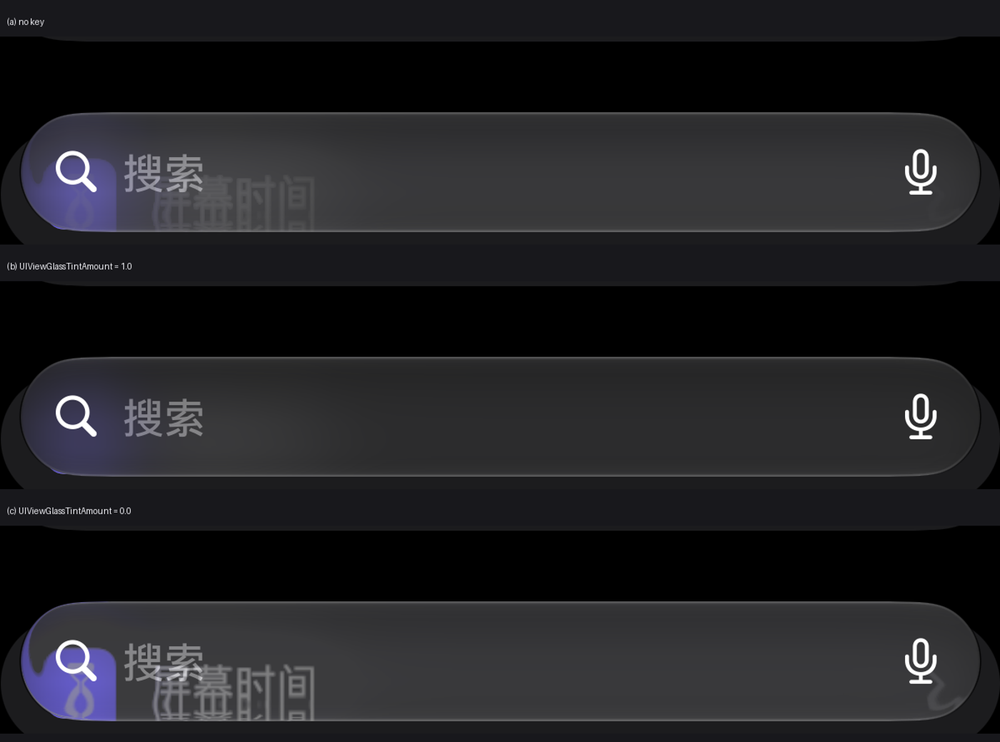
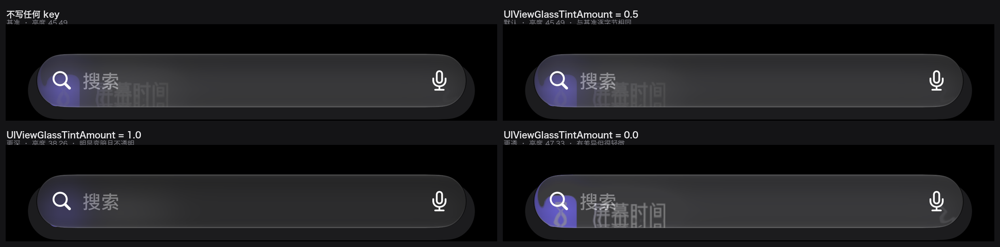
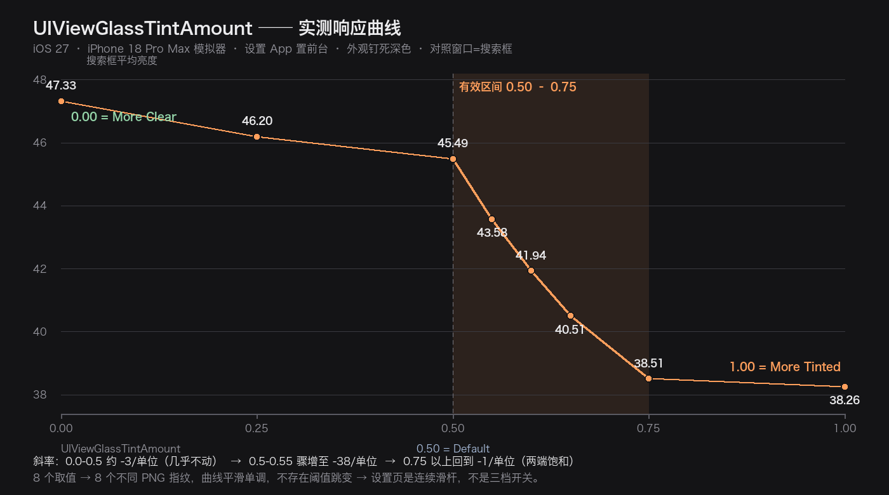
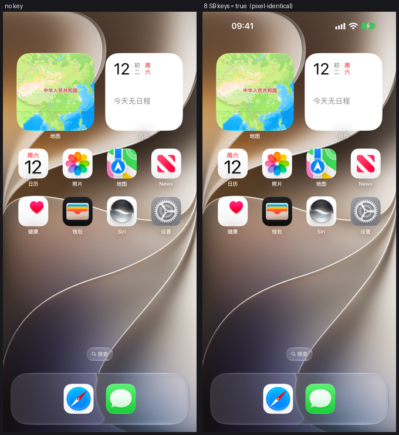

# 在 iOS 模拟器里验证 plist tweak

> 工具：`tools/sim_tweak_verify.py`（活体验证）、`tools/dyld_cache_lookup.py`（key 归属到框架 + 键表 dump）
> runtime：iOS 27.0 `24A5380i`（本机唯一已装）　　device：iPhone 18 Pro Max
> 全部数字为 2026-09-12 本机实测。

## 一句话

模拟器能验**「这个 key 有没有用」**，不能验**「Nugget 的写入路径通不通」**。
而且「没测出变化」要先排除环境问题，才能当成「没用」—— 本文档 §2 的三条规则就是为此。

---

## 1. 边界（这是最重要的一节）

### 能验

| 能验什么 | 怎么做 | 实测例证 |
| --- | --- | --- |
| key 是否被系统真的读到 | 写进去 → 重启消费者 → 比对画面 | `UIViewGlassTintAmount=1.0` → 1.196% 变化，肉眼可见搜索框由半透明变不透明 |
| key 属于哪个域 | `xcrun simctl spawn <udid> defaults read <domain> <key>` | `UIViewGlassTintAmount` 在 `com.apple.UIKit` 生效 |
| 消费者期待什么类型 | 写对类型才生效 | 同上；该 key 实测以 Float 生效（写错类型的对照组尚未做） |
| 数值型 key 的档位语义 | 逐个取值比对画面 | `UserInterfaceStyleMode` 1=Light / 2=Dark |
| **某个取值是不是系统默认** | 写该值 vs 完全不写，比字节指纹 | `TintAmount = 0.5` 与「不写」逐字节相同 ⇒ 0.5 是出厂值 |
| 某条回退通路到底通不通 | 屏蔽高优先级的那个 key 再测 | `LegibilitySetting` 0/1/2 加屏蔽后仍零变化 |

### 不能验

**模拟器根本不实现 Managed Preferences。**

Nugget 的写入路径是 `/var/Managed Preferences/mobile/*.plist`
（`FileLocation.springboard` / `.globalPreferences` / `.uikit` / `.airdrop` …），
也就是 `ManagedPreferencesDomain`。在模拟器上把覆盖层放到对应的宿主机路径：

```
data/private/var/Managed Preferences/mobile/com.apple.springboard.plist
        ↓
defaults read com.apple.springboard NuggetMPProbe
Error: Could not find key 'NuggetMPProbe' in domain 'com.apple.springboard'.
```

**同一个 key 写进 HomeDomain 立刻能读到** —— 所以不是路径写错，是单纯没有这一层。

推论：模拟器上**无法**验证「备份还原时把 overlay 装上去，系统会不会读」。
这一环只能在真机 / 真机备份上验（设备侧证据见 `LiquidGlass_Keys.md` 的写到哪里一节）。

另外不能验：三阶段还原、protective backup 的 `_SKIP_FILES` 排除逻辑。

### 工具怎么处理这个差异

模拟器内的 `defaults write com.apple.X KEY` 会落到
`data/Library/Preferences/com.apple.X.plist`，也就是 **HomeDomain 的同名域**。
Managed Preferences 的 overlay 语义就是「盖在 HomeDomain 之上」，所以
**把 overlay 目标翻译成同名 HomeDomain 域，验的是 key 语义，不是 overlay 语义**。
脚本按路径自动推导域名（`com.apple.*.plist` → 同名域，`.GlobalPreferences` → `NSGlobalDomain`），
新增 `FileLocation` 不用改脚本。

---

## 2. 三条硬规则（不遵守就一定得到错结论）

### 规则一：冻结状态栏

```
xcrun simctl status_bar <udid> override --time 9:41 --dataNetwork wifi --wifiMode active \
  --wifiBars 3 --cellularMode active --cellularBars 4 --batteryState charged --batteryLevel 100
```

不冻结的话，光时钟走出 1 分钟就制造约 **9%** 的「变化」。

### 规则二：用 respring，不要重启整机

| 操作 | 实测噪声底 |
| --- | --- |
| 连续两帧，什么都不做 | **0.000%** |
| respring + 等渲染 | **0.000%** |
| 整机重启 | **35.688%** ← 完全不可用 |

整机重启之所以炸，是**资源（壁纸、图标）加载完成的时机不确定**：一次重启里两张截图
可能一张是「已加载」、一张还是「灰占位符 + 黑背景」，两者差异 35.7%。
所以 A/B 必须在**同一个启动周期**内完成。

### 规则三：等画面稳定，**并且等资源加载完**

SpringBoard 会**先画出 Home 再加载资源**。未加载态长这样：壁纸是纯黑、每个 app 图标是灰色圆角方块。
**而这个状态是「稳定」的** —— 于是「连续两帧相同」的判据会直接接受它，
整个 A/B 就跑在「半加载 vs 半加载」上，读出完美的 0.000%，看起来像铁证说 key 没用。

实测判别（图标网格区 `y 33–50%` 的平均饱和度）：

| 画面 | 平均饱和度 |
| --- | --- |
| 未加载（灰占位符 + 黑背景） | **0.0** |
| 已加载（全彩图标 + 壁纸） | **66.0** |

- 阈值取 `>= 20`。
- **不要用「不同颜色数」判别** —— 灰占位符的抗锯齿也有 5.7 万种颜色，完全分不开。

另一个坑：`simctl launch` 起来的 app，**启动闪屏是纯黑的**，且持续时间和固定 sleep 无关。
`wait_ready()` 现在的判据是：**非黑占比 ≥ 5% + 连续 3 帧字节完全相同 + 图标区饱和度 ≥ 20**；
应用模式跳过饱和度那一条。

`band_report()` 的可用性判据是**均值 + 方差**，不是「非黑」：

| 画面 | 平均亮度 | 方差 | 判定 |
| --- | --- | --- | --- |
| 黑启动屏 | 0.0 | 5 | 无效 |
| 黑屏 + 转圈 | 0.0 | 6 | 无效 |
| 主页·已加载 | 139.5 | 4382 | 可用 |
| 主页·未加载（灰方块） | 46.1 | 6595 | 可用 |
| 设置页·深色 | 24.1 | 1198 | 可用 |
| 设置页·浅色 | 244.5 | 1059 | 可用 |

判据：`方差 < 100 或 均值 < 8 或 均值 > 250` ⇒ 本次采集无效，`band_report` 返回 `-1.0`，
调用方必须拒绝据此下结论。真实画面最低方差 1059，空白帧最高 6，间隔很大，很好分。

> 早先只判「非黑」是**不够的**：设置页浅色模式的平均亮度 244.5，
> 一张**白色**启动屏照样能混过去，于是三次实测读出完全相同的 245.13，
> 看起来像「三种取值都一样」，其实三张都是同一张空白页。护栏必须是双向的。

> 黑屏那一侧也是踩出来的：护栏加上之前，`UIViewGlassTintAmount` 跑出过 **67.8%** 的
> 「巨大变化」，看图发现是「黑启动屏 vs 已渲染的设置页」，与 tint 毫无关系。

> 已知残留噪声：状态栏的**电池图标颜色**偶发在绿/灰之间跳（覆盖层短暂失效），
> 约 0.245% 像素、集中在 `y 73–122`。它会伪装成「某档位有效」。
> 遇到小数值且 bbox 落在状态栏区，先按噪声处理，重跑确认。

---

## 3. 用法

```bash
P=/Users/jason/.workbuddy/binaries/python/envs/default/bin/python   # 需要 Pillow

# 列出全部 spec 及其在模拟器里的目标域
$P tools/sim_tweak_verify.py --list

# 校准噪声底（先跑这个，确认这台机器上方法可用）
$P tools/sim_tweak_verify.py --calibrate

# 阳性对照：证明 写入 → 读取 → 渲染 这条管线是通的
$P tools/sim_tweak_verify.py --control Light

# 验 registry 里的 tweak（按 TweakID 或 plist key 都能匹配）
$P tools/sim_tweak_verify.py --tweaks SBDisableDockSpecular SBExcludeDockShadow

# 绕过 registry 直接指定偏好 —— 下列 key 已不在 registry（见 §6 开头的状态更正）
$P tools/sim_tweak_verify.py --key com.apple.UIKit/UIViewGlassTintAmount=1.0

# 应用级偏好：截图前把 app 拉起来并重启它
$P tools/sim_tweak_verify.py --key com.apple.UIKit/UIViewGlassTintAmount=1.0 \
    --foreground com.apple.Preferences

# 把浅/深色钉死（强烈建议：不钉的话设备会停在上一轮遗留的模式里）
$P tools/sim_tweak_verify.py --appearance Dark \
    --key com.apple.UIKit/UIViewGlassTintAmount=1.0 \
    --foreground com.apple.Preferences

# 绕过 registry 直接测假说（换域对比时用）
$P tools/sim_tweak_verify.py --key com.apple.springboard/SomeKey=true

# 测「回退通路」时必须屏蔽掉优先级更高的那个 key，否则测的其实是它
$P tools/sim_tweak_verify.py \
    --key com.apple.UIKit/UIViewGlassLegibilitySetting=1 \
    --clear com.apple.UIKit/UIViewGlassTintAmount \
    --foreground com.apple.Preferences
```

行为约定：

- 采基线前**先删掉待验的 key**。否则 key 已在位时基线==结果，会静默报「无变化」（假阴性）。
- 默认结束自动回滚；`--keep` 保留。
- `--foreground` 会 `terminate` + `launch` 目标 app，因为 UIKit/Settings 这类偏好是**启动时读一次**的。
- `--appearance` 会在**每次采集前**重新写入明暗模式。这不是可有可无的：浅色下 glass 渲染不同，
  一轮跑下来中途变了模式，前后帧会读成一样。2026-09-12 就栽过这一次。
- `--clear DOMAIN/KEY` 让某个 key **整轮保持缺失**。测 legibility 这类「有优先级的回退通路」必须用它，
  因为 `UIViewGlassTintAmount` 存在时会直接短路掉 legibility 分支 —— 不屏蔽就会把
  「amount 没生效」误读成「legibility 没生效」。

### 阳性对照用的 key（重要发现）

`AppleInterfaceStyle` 是 **macOS** 的机制，在 iOS 模拟器上写它 **0.000% 变化**，别拿它当对照。
iOS 26/27 的明暗模式在：

```
com.apple.uikitservices.userInterfaceStyleMode  →  UserInterfaceStyleMode
                                                    1 = Light, 2 = Dark
```

写 2 后整屏 **88.54%** 变化、亮度 145 → 59。这才是可用的对照。

`--control` 会**先把基线强制设成相反模式**再采第一帧。这一点必要：
如果当前已经在目标模式，采出来的基线就是目标本身，结果是 0.000%，
读起来跟「管线坏了」一模一样 —— 这个假警报在这台机器上浪费过一小时。
**永远不要把同一个值跟它自己比。**

---

## 4. 反向取证法（挖 key 名最省事的办法）

要问「用户点这个开关时，系统到底写了哪个 key」——不要猜，让它自己写给你看：

```bash
# 1) 拍一份偏好存储快照
# 2) 通过系统自身改一次设置（simctl / 设置 app / 深链）
xcrun simctl ui <udid> appearance dark
# 3) 再拍一份，diff
```

`UserInterfaceStyleMode` 就是这么找到的。凡是模拟器/模拟器 CLI 能驱动的设置，
都能用这招反推真 key 名，比在 dyld cache 里大海捞针快得多。

> 注意：`xcrun simctl ui appearance` 走的是**渲染侧** oracle，它本身不改 guest 的偏好存储；
> 需要「系统自己写盘」时要用设置 app 点，或找对应的 guest 侧进程。

---

## 5. 排序手段：先查 key 属于哪个二进制

在花时间做活体验证之前，先花 10 秒确认这个 key 归哪个 framework —— 这决定了它**有没有可能**生效。

`tools/dyld_cache_lookup.py` 把 dyld shared cache 的镜像表解析出来，于是字符串搜索从
「这个符号存在于系统某处」升级成「这个符号在 X.framework 里」：

```bash
RR="/Library/Developer/CoreSimulator/Volumes/iOS_24A5380i/.../iOS 27.0.simruntime/Contents/Resources/RuntimeRoot"
CACHE="$RR/System/Library/Caches/com.apple.dyld/dyld_sim_shared_cache_arm64"

P=/Users/jason/.workbuddy/binaries/python/envs/default/bin/python
$P tools/dyld_cache_lookup.py "$CACHE" \
    SBDisableDockSpecular SBUseFlatIconsEverywhere UIViewGlassTintAmount
```

输出（实测）：

```
  HIT   SBDisableDockSpecular        x1  .../SpringBoardFoundation.framework/SpringBoardFoundation
  HIT   SBUseFlatIconsEverywhere     x1  .../SpringBoardFoundation.framework/SpringBoardFoundation
  HIT   UIViewGlassTintAmount        x3  .../UIKitCore.framework/UIKitCore
  HIT   UIViewGlassTintAmount        x1  .../SetupAssistant.framework/SetupAssistant
```

结论：

- 本文档提到的 **10 个 SB 玻璃/镜面 key（含已上线的 `SBDisableSpecularEverywhere` /
  `SBDisableGlassDock`）全部住在 `SpringBoardFoundation.framework`** —— 表是真的，框架模拟器里也有。
- `UIViewGlassTintAmount` 住在 **UIKitCore**（另有 `SetupAssistant` 一条，对应装机助手那条通路）。

> 注意：`SpringBoard.app/SpringBoard` 本身只有 133 KB，是个瘦壳，里面搜不到这些 key。
> 找不到不等于不存在，得去 cache 里按镜像查。

### 5.1 顺手把整张键表挖出来（`--pool`）

`__cstring` 里相关的字面量是**挨着放的**，所以命中一个 key 之后把邻域 dump 出来，
往往一次就能拿到整张表 —— 这比一个个 grep 高效得多：

```bash
$P tools/dyld_cache_lookup.py "$CACHE" UIViewGlassLegibilitySetting --pool 900
```

实测输出的一部分（UIKitCore，file offset `0x56e5694`）：

```
   0x00056e5694  UIViewGlassLegibilitySetting  <<<<<
   0x00056e56b1  UIViewGlassLegibilityDidChangeNotification
   0x00056e56dc  UIViewGlassTintAmount
   0x00056e56f2  UIViewGlassBuddyTintAmount
   0x00056e570d  UIViewGlassEverEditedInBuddy
   0x00056e572a  UIViewGlassEverEditedInSettings
   0x00056e574a  UIViewGlassTintAmountDidChangeNotification
   0x00056e5775  UIViewGlassLegibilityUpdateNotification
   0x00056e579d  UIViewGlassTintAmountUpdateNotification
```

顺带把同族 key 和 change-notification 名字一起交代了 —— 后者在任何公开文档里都没有。
另一处命中还能确认域：`SetupAssistant.framework` 里
`com.apple.UIKit` · `UIViewGlassTintAmount` · `UIViewGlassLegibilitySetting` 三个字面量连着写。

> 附注：日志里 `<?>` 表示「字符串在 cache 里找到了，但它所属的镜像是本文件之外的子缓存，
> 因此叫不出名字」。命中本身仍然有效，别把 `<?>` 当成 MISS。

---

## 6. 已跑的实例

### 正例：`GlassTintAmount`（**曾是** registry 的 tweak，已被上游回退）

> ⚠️ **状态更正（2026-09-13）**：本 key 曾以 `TweakID.GlassTintAmount` 存在
> （`7f5740b [QOL] Liquid Glass Options`），已被 `cf9d2d9 [REVERT] Remove Liquid Glass Tint Amount tweak`
> 删除（纯删除 50 行，**提交信息未给理由**）。因此下面 §6 与 §3 里
> `--tweaks GlassTintAmount` 的示例命令**现已匹配不到任何 spec**（`specs_matching` 按 key 后缀 /
> TweakID 匹配），要复现须改用 `--key com.apple.UIKit/UIViewGlassTintAmount=<值>`。
> 实测数据本身仍然有效，见 `docs/data/effective_key_value_pairs.md` §A1。

`--appearance Dark --foreground com.apple.Preferences`，每档独立跑一次，
同一台模拟器同一时段。对照窗口是设置页搜索框（`y 2640–2696`）：

| 写入 | 全屏变化 | `sha256[:12]` | 搜索框平均亮度 | 判读 |
| --- | --- | --- | --- | --- |
| 不写任何 key | — | `707c142da4f3` | 45.49 | 基准 |
| `TintAmount = 0.5` | 0.000% | `707c142da4f3` | 45.49 | **与基准逐字节相同** |
| `TintAmount = 1.0` | 1.196% | `93056824a955` | **38.26** | 明显变暗 |
| `TintAmount = 0.0` | 0.017% | `f41d619ba80d` | 47.33 | 有差异但轻微 |

肉眼看：基准/0.5 时搜索框半透明、能透出背后图标；1.0 时**变暗且不透明**，背后内容被完全遮住。
`1.0 vs 0.0` 在该区域 70.3% 的像素不同，最大通道差 46。



取值对照（左上「不写」与右上「= 0.5」肉眼完全一致，左下 `1.0` 明显变暗不透明）：



**两条结论**：

1. `UIViewGlassTintAmount` 在 iOS 27 上真的被读、真有观感差异，且 `1.0` 与默认**明显不同**。
2. **出厂默认就是 0.5**：写 `0.5` 与「完全不写这个 key」渲染出的 PNG **逐字节相同**。
   这是从另一个方向独立佐证了汇编里 `legibility 0 → 0.5` 那一支。

顺带一个方法论上的杠杆：**同一环境的重复采集能到逐字节相同**，
所以「同值必同图」是可以当强判据用的，比「变化小于阈值」有力得多 ——
`0.5 = 默认` 这个结论正是靠它得出的，差别只有 0.000% 的话是分不清「相同」和「噪声」的。

### 设置页到底是三档还是滑杆？——把设置 App 自己当 oracle

想直接确认「1.0 = Tinted」这档，最干净的办法是打开设置里的液态玻璃页看哪档被打勾。
`simctl openurl settings-navigation://…` 被拒（`LSApplicationWorkspaceErrorDomain code=115`）——
`Preferences.app/Info.plist` 里 `settings-navigation` 与 `prefs` 都声明了
`CFBundleURLIsPrivate: true`，外部跳不进去。改从框架自身找答案：

**`DisplayAndBrightnessSettings.framework` 的本地化文案**（`en.lproj/Display.strings`，
中文档同样齐全）给出了权威语义：

```
LIQUID_GLASS_TINT_AMOUNT              = "Tint Amount" / "色调值"
LIQUID_GLASS_TINT_DESCRIPTION_CLEAR   = "More Clear" / "更透明"
LIQUID_GLASS_TINT_DESCRIPTION_DEFAULT = "Default"    / "默认"
LIQUID_GLASS_TINT_DESCRIPTION_TINTED  = "More Tinted"/ "色调更深"
LIQUID_GLASS_SETTING_FOOTER           = "Clear is more transparent and tinted increases
                                         opacity, adding contrast to content and controls."
```

三条描述是**相对位置**（比默认更透/默认/比默认更深），不是三个独立档位。

**符号表给出了决定性证据**——`DBSLiquidGlassView`（显示设置页）拉起的是带
`neutralValue` 的 SwiftUI 滑杆，不是分段控件：

```
_$s7SwiftUI6SliderV5value2in12neutralValue13enabledBounds5label
  07currentG5Label07minimumgL007maximumgL05ticks16onEditingChanged…
```

加上 ivars `_sliderValue` / `_isEditingSlider` / `_sliderCapsuleWidth` /
`_hasMeasuredSliderCapsule`，以及 `AppearanceSettings` 里**唯一一个** 0.5 比较常量 ——
那个 0.5 就是滑杆的 `neutralValue`，作用是**决定显示哪条文案**，不是档位边界。

**实测交叉验证**：把中间取值补齐成 8 点扫描（`0.00/0.25/0.50/0.55/0.60/0.65/0.75/1.00`），
如果真是三档，0.5 两侧应该有跳变；实际得到 **8 个不同指纹、平滑单调**的曲线：

| amount | `sha256[:12]` | 搜索框亮度 | Δ（相对前一点） |
| --- | --- | --- | --- |
| 0.00 | `f41d619ba80d` | 47.33 | — |
| 0.25 | `4c58fb12f338` | 46.20 | −1.13 |
| 0.50 | `707c142da4f3` | 45.49 | −0.71 |
| 0.55 | `2d47d622a7de` | 43.58 | **−1.91** |
| 0.60 | `762a546d45c9` | 41.94 | −1.63 |
| 0.65 | `af225ca929b7` | 40.51 | −1.44 |
| 0.75 | `a71a3d6c89ed` | 38.51 | −2.00 |
| 1.00 | `93056824a955` | 38.26 | −0.25 |



斜率 ≈ −3/单位（<0.5）→ **−38/单位（0.5–0.55）** → ≈ −1/单位（>0.75）：
两端饱和，可见变化集中在 **0.50–0.75**。⇒ **连续滑杆，且响应极不均匀**。
这也是 registry 里 `step=0.05`（而不是贴着三档取 0.5）的依据 ——
限制成 0.5 会把整个过渡区砍掉。

**给文档定性的三条修正**：

1. 不要再把 spec 描述成「和设置页一样的三档」——设置页是滑杆，Clear/Default/Tinted
   只是滑杆的动态文案。
2. `1.0 = More Tinted` 现在是「两条独立证据夹逼」（框架文案 + 单调曲线端点），
   不再是纯推断。
3. 响应曲线**必须实测**：0.0 和 0.5 几乎一样、0.75 和 1.0 几乎一样，
   「取值线性映射到观感」的直觉在这个 key 上是错的。

### 越界值被 clamp 回 `[0,1]`（字节级坐实）

registry 侧一直按「OS 会 clamp」设计，但这是假设。实测把它变成观察结果：
写入越界值，与对应端点的既存截图比指纹：

| 写入 | `sha256[:12]` | 与谁相同 |
| --- | --- | --- |
| `TintAmount = -0.5` | `f41d619ba80d` | **逐字节 = `0.0` 那张** |
| `TintAmount = 1.5` | `93056824a955` | **逐字节 = `1.0` 那张** |

且两者变化区域都精确落在搜索框带（`y 2640–2695`），全屏数字分别复现 0.0 档的
0.017% 与 1.0 档的 1.196%。⇒ 二进制里 `setTintAmount` 的 clamp 是活的行为，
越界写入安全、不需要调用方自己兜底。

### 反例：`UIViewGlassLegibilitySetting`（六点扫描，预测被实测否掉）

同一套环境、同样钉死后，逐个取值：

| 写入 | 全屏变化 | `sha256[:12]` |
| --- | --- | --- |
| `LegibilitySetting = 0` | 0.000% | `707c142da4f3`（= 基准） |
| `LegibilitySetting = 1` | 0.000% | `707c142da4f3`（= 基准） |
| `LegibilitySetting = 2` | 0.000% | `707c142da4f3`（= 基准） |
| `LegibilitySetting = 0/1/2` + `EverEditedInSettings = true` | 0.000% | `707c142da4f3`（= 基准） |

分析 `DisplayAndBrightnessSettings` 得到过一组预测（`legibility 0 → amount 0.5`、
`1 → 1.0`、`其他 → 0.0`），实测**只在 `0 → 0.5` 这一支上吻合**（因为 0.5 就是基准），
另外两支完全没有复现。

于是「`UIViewGlassEverEditedInSettings` 是 legibility 的生效闸门」这个假设**被证伪** ——
加了闸门之后三档仍然逐字节等同基准。

同时这也**证否了 registry 里的一处说法**：整轮扫描中 `UIViewGlassEverEditedInSettings`
从头到尾都不存在，而 `TintAmount = 1.0` 照样改变了渲染
⇒ 「不写伴随键 iOS 就会忽略取值」**不成立**。伴随键仍保留（设置 App 自己写档位时就是这么写的，
且进程之外的表层是否以它为闸门无法排除），但不应再被描述成必需。

> `LegibilitySetting = 2` 那一轮曾出现 0.245% 的差异，看着像「有点效果」。
> 裁图后发现是**状态栏电池图标由绿变灰**，纯噪声；重跑即消失。
> 这正是 §2 那条「bbox 落在状态栏区就按噪声处理」的由来。

### 空结果：Tier 1 那 8 个 SpringBoard 玻璃/主屏开关

`SBDisableWidgetSpecular` / `SBDisableDockSpecular` / `SBDisableFolderSpecular` /
`SBExcludeAllClearGlassShadows` / `SBExcludeDockShadow` / `SBExcludeSearchShadow` /
`SBUseFlatIconsEverywhere` / `SBDisableParallax`，分别写入**两个候选域**：

| 目标域 | 全屏变化 |
| --- | --- |
| `NSGlobalDomain`（registry 当前选择，与在线同类一致） | **0.000%** |
| `com.apple.springboard`（模拟器冷启动实测的落盘域） | **0.000%** |

**最关键的是下面这一条**：把「8 个 key 全开」的 Home 截图与「全部清空」的 Home 截图并排比
（两帧都通过饱和度判据确认是**已加载态**，图标区饱和度都是 66.0）：

```
  全屏变化(>8): 0.000%
  Dock 条 / 搜索 pill 区域: 单像素差 = 0（不是低于阈值，是恰好 0）
```

肉眼比对也完全一致 —— 图标、壁纸、Dock、搜索框没有任何差别。



### 怎么解读这个空结果

「测不到」有三种解释，这次需要逐条排除：

| 解释 | 是否成立 | 依据 |
| --- | --- | --- |
| key 是假的 / 不存在 | **否** | 10 个 key 全在 `SpringBoardFoundation.framework` 里，含 3 个已上线的 |
| 域写错了 | **否** | 两个候选域都试了，都是 0.000% |
| 这环境不渲染该效果 | **最可能** | 同一套方法验 `UIKitCore` 的 `UIViewGlassTintAmount` 就出效果（1.196%），说明管线本身没问题 |

也就是说：**方法在同一个模拟器上能测出效果（tint），测不出另一批（SB 镜面/阴影）。
差别在框架，不在方法。** 最可能是模拟器不渲染这些镜面高光/投影、或该代码路径在模拟器上不激活。

**结论：这批 key 在模拟器上无法验证，需要真机。** 这个结论现在是扎实的
（基于已加载态、双域、并排肉眼比对），不再是「没测到所以不确定」。

---

## 7. 未决

- 那 8 个开关在真机上是否生效 —— 模拟器验不了，只能真机。
- `UIViewGlassLegibilitySetting` 在模拟器上零效果，三种解释都还没排除干净：
  (a) 该效果只在特定玻璃表层出现；(b) 模拟器渲染器不实现扩散/易读性那一轴；
  (c) 偏好只是持久化镜像，真正生效要走 `_UIViewGlassSetLegibilitySetting()` 运行时 API。
  它的**档位名字**（`LiquidGlassLegibilityRegular` / `…Tinted` 之类）也只有间接来源，
  不要写进面向用户的文案。
- `UIViewGlassEverEditedInSettings` 在**跨进程**表层的必要性待真机。
- SpringBoardFoundation 那批 Defaults 类的具体 suite 名未从二进制反解
  （窗口里同时出现 `com.apple.springboard` 与 `com.apple.UIKit`，且类是
  `*Defaults` / `_bindAndRegisterDefaults` 的 PrototypeTools 风格）。
  两个候选域实测无差别，所以这一项不影响上面的结论。
- 想让 `1.0 = Tinted` 彻底落定，只差在设置里目视确认选中的档位 —— 模拟器能做，
  但要 UI 自动化（点击 radiogroup）。当前证据是「写入路径 clamp 到 [0,1]」+「1.0 与默认明显不同」，
  两条夹逼，不是直接读出。
